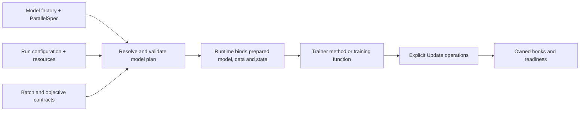

**Status: recommended design, September 17, 2026.** Evaluates the sibling v2 implementation
and supersedes earlier API sketches where they conflict. Proposed names and code below are
illustrative contracts, not implemented or executable examples. The runtime was not changed
by this review. The [product requirement](../../dream-trainer-v2/docs/define-once-parallelism.md)
is configuration-only scaling of one model family and training algorithm across supported
N-D layouts. The [TorchTitan review](../../dream-trainer-v2/docs/torchtitan-nd-parallelism.md)
provides the upstream implementation evidence.

The newer [composable execution proposal](../../dream-trainer-v2/docs/composable-execution.md)
adds a shared program contract and native/graph execution engines. It supersedes assumptions
below that model preparation and backward must be implemented directly by the core runtime.
A first limited graph integration is now implemented; see
[current graph execution coverage](../../dream-trainer-v2/docs/graph-execution.md).
Implementation findings later in this review describe its original snapshot;
[current parallelism coverage](../../dream-trainer-v2/docs/parallelism.md) tracks newer work.

## Recommendation

Keep the explicit experiment lifecycle, typed class/function frontends, ordinary PyTorch
models and optimizers, and Update ownership. Preserve the original ecosystem's component-local
parallelism declarations. Collect and validate those declarations into a model plan before
applying transformations. Bind data, objectives, RNG, metrics, extensions, and checkpoint
ownership to that plan.

The public API should hide distributed implementation mechanics while leaving objective math
and algorithmic control flow visible. A user changes configuration to choose DDP or
FSDP + TP + EP. They do not edit preparation order, group arithmetic, or loss scaling.

## Comparison with the original library

The original experience spans three packages, not just this repository:

- `dream-trainer` owns configuration, mesh construction, setup order and the loop.
- `fsdp2-utils` recursively collects and applies component-local parallelism plans.
- `models` supplies those plans alongside the attention, feed-forward and expert code.

That last part is worth preserving. [FeedForward.parallelize_plan](../../models/src/models/layers/ff.py)
declares two or three local row/column rules. The
[recursive collector](../../fsdp2-utils/src/fsdp2_utils/tensor_parallel/apply.py)
visits children, so a parent model does not repeat every child's internals. Real trainers often
just forward `apply_tensor_parallel`, `apply_fully_shard`, and `apply_compile` to model helpers;
see [the class-conditioned trainer](../../models/src/models/models/scratch/class_conditioned/train2.py).

| Concern | Original dream-trainer ecosystem | Recommended v2 |
| --- | --- | --- |
| Scale selection | `DeviceParameters` presets and named dimensions | Keep concise typed configuration; resolve without mutating the requested config |
| Model knowledge | Local `parallelize_plan()` methods collected recursively | Keep locality; pure typed declarations referring to actual modules/parameters |
| Trainer parallelism code | Separate forwarding hooks for TP/FSDP/DDP/compile/checkpointing | One model preparation call; no forwarding hooks for standard policies |
| Composition | Recursive application and a fixed hook order | Collect, validate the combined plan, then apply supported transformations |
| EP | Expert styles exist in sibling utilities/models but use the TP application path | Distinct TP/EP policies and dense/expert mesh views, with validated transfers |
| Data | Trainer explicitly passes DP rank/size | Typed loader context derived from the logical data domain |
| Registration | Assignments intercepted during setup | Explicit registration returning concrete typed objects |
| Extensions | Mixins, callbacks and component methods share lifecycle work | Small typed bindings with explicit owners and fixed phases |

The original mesh implementation already distinguishes `dp`, `dp_shard+cp` and `dp+cp`; v2's
current single `data` mesh is a regression in expressiveness. See
[construct_mesh](../src/dream_trainer/trainer/world/distributed_world.py).
However, the original config has no independent EP degree, and its PP setup path explicitly
raises `NotImplementedError`. These are implementation limits, regardless of broader docs claims.
The existing expert styles do not establish arbitrary independent TP + EP composition.

The confusing part is the split ownership: model plans use string keys, FSDP is often applied by
side-effectful component methods, the trainer forwards hooks, and callbacks may add preparation
or synchronization behavior. Preserve the local knowledge while consolidating the execution.

The earlier draft of this proposal also asked for too much: a root `GQAttention`/`RoutedExperts`
tree repeating every nested projection is a second description of the model. It should not be
the normal API. TorchTitan's layout and communication machinery belongs behind concise local
contracts. Its current [Llama sharding implementation](https://github.com/pytorch/torchtitan/blob/a3a819c67fe2fbc903e979bdc9752983f33505dd/torchtitan/models/llama3/sharding.py)
already reuses component helpers; the useful next step here is preserving declarations with
the reusable components themselves.

## What to retain and what to change

| Area | Evaluation | Decision |
| --- | --- | --- |
| Class/function frontends | Both already bind to one runner | Keep; present the class form first for cohesive experiments |
| Fully initialized trainer dataclasses | Required components are visible to the type checker | Keep `build(...) -> Self`; avoid delayed attribute creation in `setup()` |
| Concrete models and optimizers | Useful for research and custom operations | Preserve model type and standard optimizer construction |
| Explicit Update | Good boundary for ownership, bundles, clocks and readiness | Keep; replace 1D-FSDP assumptions with resolved layout semantics |
| Imperative `prepare(model, runtime)` | Requires experiments to assemble distributed mechanics | Advanced escape hatch; default to collected component declarations or a typed external adapter |
| One Runtime mesh/global rank | Cannot represent data, dense, expert and objective domains | Introduce internal per-model plans and named topology views |
| Data and normalization | Loader construction and objective scaling leak topology | Typed data factories, logical batch configuration, provenance-aware normalization |
| Observers/owned hooks/services | Useful separation with explicit lifecycle guarantees | Keep; add ownership metadata and fresh per-run bindings |
| Restore/state schema | Too coarse for initialization and changing layouts | Typed restore modes, logical state ownership, structured compatibility metadata |
| Inspection | Currently prints config without resolving execution | Add model planning on meta, distinct from live materialization |

Concrete current gaps:

- [Runtime](../../dream-trainer-v2/src/dream_trainer_v2/runtime.py) creates one `data` mesh and
  equates global and data ranks. [Model construction](../../dream-trainer-v2/src/dream_trainer_v2/model.py)
  always adds FSDP for multi-rank CUDA, so an explicit DDP policy cannot currently be honored.
- [Update](../../dream-trainer-v2/src/dream_trainer_v2/update.py) normalizes by `world_size / weight`
  and world-sums the local norm of every DTensor gradient. Those rules are insufficient for
  replication, TP, CP, or mixed dense/expert ownership.
- [Data](../../dream-trainer-v2/src/dream_trainer_v2/data.py),
  [RNG](../../dream-trainer-v2/src/dream_trainer_v2/rng.py), and
  [metrics](../../dream-trainer-v2/src/dream_trainer_v2/metrics.py) have no logical-layout contract.
- [Run](../../dream-trainer-v2/src/dream_trainer_v2/run.py) stores live service instances despite
  being frozen; repeated executions should instead create fresh bindings.

## Public concepts and internal ownership

Keep `Run`, optional `Trainer`, `Runtime`, `DataSource[B]`, `Step`, and `Update`. Add
`ParallelSpec[M]` and `BatchSpec[B]` at the model/component-author boundary. Configuration
values such as `Parallelism`, `Batching`, precision, compilation and checkpoint policies
remain ordinary typed dataclasses. Do not add a mandatory Task, Engine, Strategy, and Model
wrapper hierarchy on top of these concepts.



Runtime stores a `ModelPlan[M]` alongside the concrete model. The plan owns parameter aliases,
dense/expert storage and execution views, input/output layouts, supported collectives,
normalization rules, RNG policies, preparation order, and state compatibility metadata.
Ordinary training code never edits the plan or chooses a process group.

## Configure scale and policy

Keep the existing `RuntimeConfig` name. Separate model/algorithm configuration, data batching,
and execution policy; do not turn a parallel degree into an implicit model change.

```python
small = dt.RuntimeConfig(
    parallel=dt.Parallelism(dp=dt.DDP(replicas="auto"), tp=1, ep=1, cp=1),
    precision=dt.Precision.bf16(),
    compile=dt.RegionalCompile(),
)

large = dt.RuntimeConfig(
    parallel=dt.Parallelism(dp=dt.FSDP(shards="auto"), tp=8, ep=64, cp=1),
    precision=dt.Precision.bf16(),
    compile=dt.RegionalCompile(),
)

run = dt.Run(
    trainer=Pretrainer,
    config=TrainConfig(
        model=MoEConfig.small(),
        batch=dt.Batching(global_batch=256, micro_batch=4),
    ),
    runtime=small,
    max_steps=100_000,
    observers=(dt.Console(),),
    checkpoint=dt.Checkpoint(root="runs/ablation", every=dt.Every(1_000)),
)
dt.run(run)
```

The larger job selects `large` and a larger model config, and may tune batch/compile/memory
policy in config. It uses the same model family, specification, builder, and training method.
Experts execute locally at EP=1 and use the selected dispatcher at larger degrees. Runtime
resolves `auto` and expert mesh views; EP is not an extra independent world-size multiplier.

`global_batch` counts independent examples, not TP/CP/EP copies. `micro_batch` is per logical
data partition before CP. The data plan derives accumulation and rejects impossible batch
divisibility. Token-budget batching can be a separate explicit policy with variable counts.
Padding and dropping are explicit policies rather than silent adjustments to the objective.

## Describe the model once

Each reusable component describes its own parallelism. The ordinary `nn.Module` can implement
one structural protocol; no additional module base class is required. For example, the original
SwiGLU declaration can become typed rules using module references:

```python
class SwiGLU(nn.Module):
    # __init__ and forward remain normal model code.

    def parallel_spec(self) -> dt.ParallelSpec[Self]:
        return dt.ParallelSpec(
            model=self,
            rules=(
                dt.Colwise(self.w1),
                dt.Colwise(self.w3),
                dt.Rowwise(self.w2, output=dt.SequenceShard(dim=1)),
            ),
        )
```

The top model declares its own boundaries and root state. It does not enumerate attention,
MLP or expert internals again:

```python
class MoETransformer(nn.Module):
    def parallel_spec(self) -> dt.ParallelSpec[Self]:
        return dt.ParallelSpec(
            model=self,
            regions=tuple(self.blocks),
            rules=(
                dt.TokenEmbedding(self.embedding),
                dt.Norm(self.norm),
                dt.VocabProjection(self.head),
            ),
        )
```

Attention and MoE components supply their own small declarations, including their attention or
dispatch adapter. Reusing those components reuses their distributed support. A stock semantic
helper can generate the local rules above for a known component family. External typed adapters
provide the same contract for third-party modules without editing their source; bindings are
explicit per preparation, not a mutable global plugin registry.

Collection is deterministic and separate from application. The planner validates input/output
boundaries, aliasing, coverage, divisibility, and transfers across the combined declarations
before modifying the model. Conflicting parent/child rules fail with their source locations;
there is no implicit last-writer-wins override. Rules describe logical axes; disabled axes
resolve to identity. DDP/FSDP-only models do not need per-tensor TP declarations.

Regions are candidate boundaries for sharding, checkpointing and compilation; separate policies
choose how to use them. Declared regions do not prove execution order in a dynamic model, so
prefetch schedules require a supported execution contract. Custom buffers, rotary caches,
nonstandard outputs and tied parameters must be covered by the component contracts. Ordinary
replication is valid when the contract specifies it; unknown semantics must not silently pass.

No declaration reads a process group or runs FSDP/compile directly. The same component method
is used at TP=1 and TP>1, EP=1 and EP>1. A typed external `parallel(model)` function remains an
alternative to methods, using the same collector and resolver.

Canonical FQNs are generated for diagnostics and checkpoints. Public model declarations use
concrete references so attribute renames and wrong component types remain visible to Python
typing. Avoid a general-purpose sharding DSL and string-key tensor dictionaries as the main API.

This extends the useful upstream idea of state and activation layout declarations with
explicit transfers. [TorchTitan sharding contract](https://github.com/pytorch/torchtitan/blob/a3a819c67fe2fbc903e979bdc9752983f33505dd/torchtitan/protocols/sharding.py)

## Build concrete state, then write ordinary training

The default frontend is a shallow class with required fields. `Config`, model, batch, loader,
and loss helpers below belong to the experiment/model package and have concrete signatures.

```python
@dataclass(kw_only=True)
class Pretrainer(dt.Trainer[TrainConfig]):
    model: MoETransformer
    data: dt.DataSource[TokenBatch]
    update: dt.Update

    @classmethod
    def build(cls, config: TrainConfig, runtime: dt.Runtime) -> Self:
        model = runtime.model(
            "model",
            factory=lambda: MoETransformer(config.model),
            initialize=initialize_transformer,
            features=config.model_features,
        )
        data = runtime.data(
            "train",
            factory=lambda context: make_loader(config.data, context),
            for_model=model,
            layout=token_batch_spec,
            batching=config.batch,
        )
        optimizer = torch.optim.AdamW(model.parameters(), lr=config.lr)
        update = runtime.update(
            MODEL_UPDATE, optimizer, models=(model,), clip_grad=1.0,
        )
        return cls(
            config=config, runtime=runtime,
            model=model, data=data, update=update,
        )

    def train_step(self, step: dt.Step) -> None:
        window = step.window(self.data)
        normalization = self.update.normalizer(window, weight=valid_tokens)

        self.update.zero_grad()
        for micro in window:
            with self.update.microbatch(micro):
                logits = self.model(micro.batch)
                loss_sum = token_loss_sum(logits, micro.batch.targets)
                self.update.backward(loss_sum, normalization=normalization)
                step.mean(
                    "loss", total=loss_sum,
                    weight=valid_tokens(micro.batch), source=micro,
                )
        self.update.step()
```

Changes from the current loop:

- `runtime.model` collects component declarations by default; an explicit `parallel=` adapter
  supports external models. It returns the concrete model after preparation. In this example
  the model accepts a typed `TokenBatch`, including declared positions and attention metadata.
- `window` derives its accumulation schedule from logical batching config. It does not clear
  gradients or choose when an optimizer steps.
- `normalizer` counts weights before CP partitioning and resolves their true contribution
  domain. It carries objective/plan provenance, not just a scaling tensor. Reductions use a
  consistent sum contract; backend gradient averaging is handled internally.
- `micro.batch` is the typed batch view for the model's execution layout. Its metadata records
  logical ownership. Movement, shared inputs, CP positions/masks, and rank cooperation are
  handled by the bound batch/model adapters.
- `update.microbatch` scopes gradient synchronization and precision. Bound model adapters
  supply their execution/RNG/attention contexts, including models not owned by this Update.
  The runtime selects the right reduce-scatter/HSDP synchronization schedule.
- `token_loss_sum` computes a local contribution, not an independently normalized mean.
  It must preserve the declared output semantics. A vocab-sharded cross-entropy implementation
  is a reusable objective adapter or supported DTensor operation, selected behind the same
  function contract. Arbitrary local math on unknown sharded outputs is not silently accepted.
- `step.mean(total=..., weight=..., source=micro)` records numerator/count contributions with
  layout provenance. The pre-CP normalization count and the post-CP reporting count are not
  assumed to have the same reduction domain. The name remains `mean`, but its explicit sum/count
  form removes ambiguous averaging of already averaged or replicated values.

Different objectives can obtain distinct normalizers over the same window. A sum objective
uses an explicit sum reduction policy. If weights depend on model outputs, an adapter must
provide a valid staging/two-pass or update-time scaling strategy; the ordinary weighted-window
API requires counts before backward. It must not approximate an unknown denominator.

`BatchSpec[B]` combines typed movement/partition rules, input/target/position/mask relationships,
and logical ownership. Stock batch types get stock specifications; custom dataclasses use
typed extraction/rebuild functions or a `BatchAdapter[B]`. `make_loader` receives a `DataContext`
with logical partition coordinates and resolved batch sizes, rather than reading global ranks.

Initialization, stochastic layers and generated noise also follow declared logical layouts.
Named RNG streams bind to model/data plans. Cross-topology sample-identical randomness requires
a keyed/counter policy; global-rank seeds do not provide that guarantee.

## Functions use the identical execution core

```python
# build: (TrainConfig, Runtime) -> TrainState
# train_step: (TrainState, TrainConfig, Runtime, Step) -> None
run = dt.Run.from_functions(
    config=config, build=build, train_step=train_step,
    runtime=runtime_config, max_steps=100_000,
)
dt.run(run)
```

The functions and class need not coexist in every experiment. A class can use helpers where
they are reused; a functional experiment can use an ordinary typed state dataclass. Do not
require a State object plus a forwarding Trainer class when the class can declare its fields.

For an ordinary single-objective update, expose one optional convenience implemented with the
same primitives:

```python
def loss_sum(self, batch: TokenBatch) -> torch.Tensor:
    return token_loss_sum(self.model(batch), batch.targets)

def train_step(self, step: dt.Step) -> None:
    self.update.minimize(
        step.window(self.data),
        loss=self.loss_sum,
        weight=valid_tokens,
    )
```

`minimize` means exactly: clear gradients, count the logical objective weights, evaluate and
accumulate each microbatch under its execution context, synchronize, clip, and step once. Its
loss callable returns a sum; its weight callable counts independent valid elements. It uses
the same normalizer and layout validation as the explicit loop. It never infers GAN phase
order or chooses which optimizer to run. Experiments needing additional per-microbatch work
can use the explicit loop above.

Primitive functions for planning, preparation, windows, backward and optimizer updates remain
available for custom loops. Runtime/Update methods delegate to them. A custom loop assumes
the documented lifecycle obligations; it does not receive a second set of distributed rules.

## Preserve multi-model and multi-update algorithms

The existing adversarial example is a required design test, not an edge case to remove.
One data window can feed multiple Updates, each with its own normalizer and clock. An Update
owns parameters it changes, not every model through which its backward passes. A frozen
discriminator can participate in a generator objective without belonging to its optimizer.

Use a common logical data domain by default. `for_model` identifies the reference domain for
a DataSource, not exclusive ownership of its batches. Other models may consume a compatible
view. Different dense/expert parameter layouts can coexist within that domain. Genuinely
different model input/output domains require a declared transfer adapter with gradient
semantics. Incompatible transfers fail; a raw local tensor is not evidence of compatibility.

Keep generator/discriminator/teacher ordering and freeze scopes explicit in the experiment.
Do not move additional forward/backward phases into lifecycle callbacks. Pipeline parallelism
needs a separately declared stage/schedule interface; do not imply arbitrary direct Python
multi-model control flow becomes a pipeline by setting a degree.

## Extensions remain small, but participate in the plan

| Extension | Selection | Library responsibility |
| --- | --- | --- |
| FP8 or other model conversion | Immutable model feature config | Validate layout compatibility; place conversions; bind state/maintenance after final model preparation |
| EMA | Bind to a concrete model and Update | Register shadows, initialize after final weights, restore correctly, update after optimizer completion |
| Logging | Observer specification/factory | Construct fresh sinks; deliver already reduced immutable events |
| Checkpoint storage | Backend specification/factory | Enforce completed-iteration saves, staging protection, persistence and cleanup |
| Optimizer compute redistribution | Optimizer configuration/adapter | Preserve ownership/readiness and persist compatibility metadata |

For example, `features=(Float8(config.fp8),)` contributes operations through a typed adapter;
the experiment does not manually order conversion against TP/FSDP/compile. An external package
can supply that adapter. Fixed preparation phases and supported combination checks are enough
initially; a numeric-priority hook system or generic dependency solver is unnecessary.

Keep `on_ready`, `after_optimizer`, `after_update`, and observation distinct. Bind operations
to concrete owners and declared affected state/domains. A feature can legitimately touch more
than one communication group. Mutating hooks finish before parameter readiness; EMA updates
its own shadows afterward. Services create fresh live objects for every run, even when their
immutable specifications are reused.

## Restoration is a typed operation

```python
dt.run(run)                                      # Fresh initialization.
dt.run(run, restore=dt.Resume.latest())           # Full supported continuation.
dt.run(run, restore=dt.WeightsInit("runs/seed"))  # Weights plus fresh training state.
```

Use a discriminated restore result with mode and restored component keys. Extensions can
preserve restored history or rebuild fresh/derived state from the final loaded model. Keep
topology-changing continuation as a separately validated restore mode with policies for
data cursors, RNG and extensions. Tensor resharding alone is insufficient; DCP supplies the
tensor-storage mechanism, while this library must define whole-run semantics.
[PyTorch DCP](https://docs.pytorch.org/docs/2.14/distributed.checkpoint.html)

**Confirmed current defect:** EMA clones weights during build, then `init_from` restores only
model weights. EMA has no post-load initialization hook. An isolated CPU probe restored model
weight `0.8000000119` while the shadow remained `1.0`. The boolean `ReadyContext.resumed` cannot
distinguish this path from a fresh start. See [EMA](../../dream-trainer-v2/src/dream_trainer_v2/extensions/ema.py)
and [restore order](../../dream-trainer-v2/src/dream_trainer_v2/runner.py).

State metadata must describe logical ownership and a structured compatibility fingerprint:
model/parameter identities and aliases, parallel layout, objective contract, optimizer
ownership/compute layout, and feature schemas. A world-size check or config `repr` is not
sufficient. Names remain stable for checkpoint keys; heterogeneous values stay at the
serialization boundary, not in normal training APIs.

## Planning, typing, and package structure

Provide a pure model-level planning API using a meta model and proposed resources:

```python
plan = dt.plan_model(
    factory=lambda: MoETransformer(config.model),
    runtime=runtime_config,
    world_size=256,
)
print(plan.explain())
```

It reports mesh views, component layouts, aliases, selected transformations, constraints and
unresolved hardware requirements without materializing weights. `runtime.model` uses the same
resolver. A full arbitrary imperative experiment builder may open data sources and construct
optimizers; do not pretend it can be dry-run without side effects. Initially scope preflight
to model planning, then validate the combined data/update/extension bindings during build.

Preserve `runtime.model(...) -> M` for type-preserving adapters. A generic `Model[M]` callable
proxy cannot infer arbitrary `M.forward` signatures, and `Any`-based attribute forwarding would
undo the typing goal. Native DDP wrapping is a real implementation constraint: the in-place
replication path in installed 2.14 is private and needs an isolated tested adapter. Never cast
a DDP wrapper to `M` and claim it preserves custom model methods.

Python typing, layout-semantic checks and numerical correctness are separate checks. Returning
`M` does not repair PyTorch's broad `nn.Module.__call__` annotations; typed model call contracts
or explicit annotated methods still matter. SPMD checking should complement the type checker,
and both should have positive and negative fixtures.

Organize the code around responsibilities:

```text
run.py / runner.py / trainer.py     experiment description, lifecycle and facade
runtime.py / model.py              binding, resources and model construction
distributed/
    topology.py                    degrees, mesh views, logical rank coordinates
    spec.py                        model/component/layout contracts
    plan.py                        validation and resolved model plans
    fsdp.py / replicate.py         PyTorch data-parallel adapters
    spmd.py                        explicit layout checks and transfers
    components/                    reusable attention, MLP, embedding and expert adapters
data.py / rng.py / metrics.py      logical data and execution-domain operations
update.py                         optimizer ownership, objective scaling and readiness
checkpoint/                       state adapters, restore policy and storage services
hooks.py / observers/ / extensions/ integration contracts and optional implementations
```

Create files as implementations arrive; this is a responsibility map, not a request to scaffold
empty packages. Keep the common run loop and update order linear and visible.

## Acceptance sequence

1. Fix restore semantics and establish typed in-place replicated/sharded model preparation.
2. Implement topology, model specifications, batch provenance and layout-aware Update together.
3. Exercise one small configurable MoE model, one set of component specs, one batch adapter and one training
   function under DDP, FSDP, TP, EP and supported combined layouts. Add CP with a supported
   attention adapter. Change configuration only.
4. Compare logical parameter updates, optimizer state, weighted objectives, clipping, metrics,
   initialization and restore. Include tied weights, zero local contribution, uneven data
   exhaustion, and mixed dense/expert gradients.
5. Exercise adversarial and diffusion algorithms, including frozen model participation and
   logical noise streams. Validate external feature bindings through the same paths.
6. Measure compilation, overlap, memory and checkpoint behavior on representative multi-node
   workloads before making large-scale performance claims.

The current test suite establishes the initial 1D implementation's behavior; it is not evidence
that this proposed N-D API works. The completion criterion is the configuration matrix with
unchanged experiment code, not the number of newly exposed parallelism flags.
