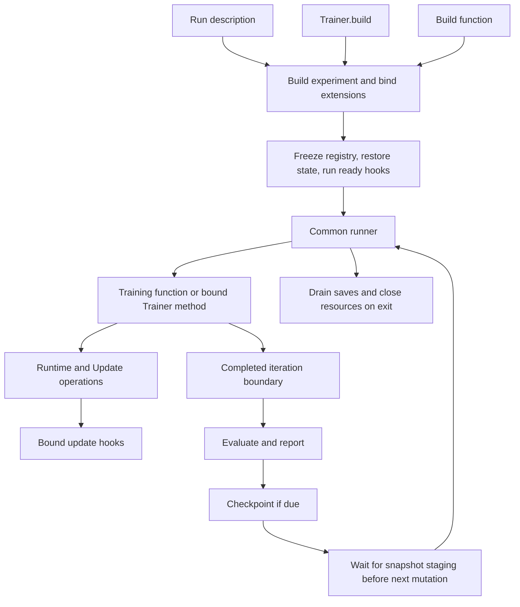

**Status: proposed architecture, September 16, 2026.** These APIs are not implemented. This is the entry point to the [API proposal](v2-proposal.md), [execution design](v2-pytorch-2.14.md), and [extension contracts](v2-extensions.md). Example experiment modules and `lab.*` packages are illustrative user code and external integrations.

V2 has one managed lifecycle, composable operations, and two ways to organize an experiment. A function receives explicit state; a Trainer method accesses declared fields. Both use the same Runtime and Update operations and the same runner. External features attach through typed contracts with explicit ownership and timing.

**Scope revision, September 17:** the central product requirement is now explicit in the
[define-once parallelism contract](../../dream-trainer-v2/docs/define-once-parallelism.md).
One reusable model specification must support changing N-D topology through configuration;
the library owns composing and applying parallelism. The lifecycle below remains applicable,
but its single-device/FSDP scope is an implementation milestone, not the complete v2 target.
The [design evaluation and recommended API](v2-ideal-api.md) supersedes the sketches below
where they differ, including preserving the original ecosystem's component-local declarations.

**Five responsibilities explain the system.**

| Piece | Owns | What an experiment author writes |
| --- | --- | --- |
| Run | Configuration, selected experiment, schedules, and service choices | A Python factory returning the run description. |
| Experiment | Models it uses, objectives, data choices, phase order, and update cadence | A typed builder and training function, or `Trainer.build` and `Trainer.train_step`. |
| Runtime | Distributed resources, registered component state, and managed resource lifetimes | Explicit construction and registration calls during build. |
| Update | A fixed optimizer or optimizer bundle, synchronization, gradient checks, update hooks, and its counter | Explicit calls to zero gradients, backward, and step. |
| Runner | Construction, restore, iteration boundaries, evaluation/reporting/save scheduling, and teardown | Normally only `dt.run(run)`. |

The Trainer is optional organization for the experiment. It does not own an alternative framework lifecycle. Runtime and Update methods delegate to the same operations available as functions.



The class and function arrows are alternatives. The runner binds the selected experiment once; it does not switch between execution styles inside the loop.

**An assembled run is ordinary Python.** This example chooses the class frontend, regional compilation, and two external services. Its initial execution recipe is CUDA/NCCL/BF16 on PyTorch 2.14+, with single-device or native FSDP2 execution as described in the API proposal.

```python
import dream_trainer as dt

from experiments.diffusion import Config, DiffusionTrainer, MODEL_UPDATE
from lab.checkpointing import DCPBackend
from lab.logging import Wandb


def experiment() -> dt.Run[Config]:
    return dt.Run(
        trainer=DiffusionTrainer,
        config=Config(),
        runtime=dt.RuntimeConfig(
            compile=dt.RegionalCompile(fullgraph=True),
        ),
        max_steps=100_000,
        observers=[Wandb(project="diffusion")],
        checkpoint=dt.Checkpoint(
            backend=DCPBackend(root="runs/dit/checkpoints"),
            every=dt.Every(1_000, clock=MODEL_UPDATE.clock),
            keep_last=3,
        ),
    )


if __name__ == "__main__":
    dt.run(experiment())
```

`MODEL_UPDATE` is a stable typed UpdateKey declared by the experiment. Build must register the matching Update before its schedule can be used. The run description can name the clock without looking up a live optimizer by string.

The experiment has two main entry points:

- **Build:** construct and prepare concrete models; construct optimizers against final parameters; register Updates, data, RNGs, and additional persistent state; bind extensions; return fully initialized experiment state.
- **Train step:** choose batches and phases; run forward/backward and explicit updates; record metrics; return only after the complete logical iteration finishes.

For example, the training function from the API proposal remains direct code:

```python
def diffusion_step(
    state: DiffusionState,
    config: Config,
    runtime: dt.Runtime,
    step: dt.Step,
) -> None:
    state.update.zero_grad()
    for micro in step.microbatches(state.data, count=config.accumulation):
        with state.update.sync(enabled=micro.last):
            with runtime.autocast():
                loss = flow_loss(state.model, micro.batch, generator=state.noise)
            state.update.backward(loss / micro.count)
        step.mean("train/loss", loss, weight=len(micro.batch.latents))
    state.update.step()
```

Here `DiffusionState` declares concrete model, typed data, Update, and RNG fields. The normalization assumes equal microbatch and rank weighting; other objectives use the explicit weighted normalizer. An adversarial experiment can write its additional forwards, backwards, and updates in this function. That control flow stays visible.

**Functions and classes meet at a bound callable.** A functional run selects the typed builder and training function directly:

```python
run = dt.Run.from_functions(
    config=Config(),
    build=build_diffusion,
    train_step=diffusion_step,
    max_steps=100_000,
)
```

It accepts the same runtime, observers, checkpoint, and evaluation options as the class form. A class can reuse these functions when sharing code is useful:

```python
@dataclass(kw_only=True)
class DiffusionTrainer(dt.Trainer[Config]):
    state: DiffusionState

    @classmethod
    def build(cls, config: Config, runtime: dt.Runtime) -> Self:
        return cls(
            config=config,
            runtime=runtime,
            state=build_diffusion(config, runtime),
        )

    def train_step(self, step: dt.Step) -> None:
        diffusion_step(self.state, self.config, self.runtime, step)
```

A class-only experiment can instead declare the model/data/update fields directly and write its algorithm in the method. It need not extract a State class and forwarding functions. Both styles produce a typed callable for the common runner after construction. Neither the Trainer nor the closure becomes a checkpoint payload: the explicit resource registry supplies persisted state.

**Extensions bind to the responsibility they need.** A feature can provide several ordinary functions without becoming a new framework subsystem.

| Feature | Construction | During training | Persistence and teardown |
| --- | --- | --- | --- |
| Logging | Select an Observer and its rank scope in Run. | Receive typed events and reporting snapshots after required reductions. | Flush bounded pending I/O and close the client. |
| FP8 integration | Convert the model in its tested preparation order; bind typed closures to its Runtime/Update. | Rebuild derived state after restore if required; maintain scales after the optimizer bundle for recipes that need it. | Register persistent history where required; reconstruct derived caches. |
| EMA | Bind to an Update and register shadow state. | Read updated weights in `after_update`; evaluation explicitly enters an EMA swap context if desired. | Restore shadows with the rest of the training state. |
| Checkpoint backend | Select a backend service in Run. | Runner invokes it at a completed iteration boundary. | Expose staging and persistence completion; drain and close during teardown. |

For an optional FP8 recipe, `fp8.bind(name="fp8/model", model=model, update=update, runtime=runtime)` is an ordinary external installer called during build. It captures concrete references and registers narrow ready/update hooks. The core does not recognize a Float8 class or dispatch on its feature name. The detailed FP8 example and its recipe constraints are in the [extension contracts](v2-extensions.md).

There are three extension mechanisms: observers, owned hooks, and services. Registration freezes after build. Hook order follows fixed core phases and explicit registration order within a phase. Feature dependencies are visible calls in the installer. Configuration needed before process-group creation belongs in the Run factory.

**One iteration has a documented order.**

```text
ensure any preceding checkpoint staging has completed
  -> call the experiment's complete train_step
       -> acquire accumulation window and run explicit forward/backward phases
       -> for each explicit Update.step:
            check/clip gradients
            step the complete owned optimizer bundle
            run after_optimizer hooks, such as recipe-specific FP8 maintenance
            publish parameter readiness
            advance schedulers and the Update counter
            run after_update hooks, such as EMA
  -> advance the completed-iteration counter
  -> run scheduled evaluation; exit temporary evaluation contexts
  -> reduce and deliver scheduled reports
  -> start a checkpoint if due, after any previous save has completed
  -> return to the next iteration, or drain saves and close resources
```

This is the proposed default boundary order. A stop/save request takes effect at a completed iteration boundary. Checkpoint staging must finish before any subsequent state mutation; persistence can overlap later training. A hook failure stops the run, and partially applied updates recover from a prior complete checkpoint. The sequence is not a rollback transaction.

Parameter readiness is an internal dependency boundary. Hooks that modify live model weights or execution buffers run before it. Later hooks may read those weights and update their own registered state. The stream-ordering contract applies to both phases. Observers receive reporting snapshots rather than a mutable trainer; detachment alone is insufficient if a tensor still aliases storage that training or graph replay can overwrite.

**The same boundaries support optimization and readability.** Preparation chooses tested sharding units and compiled regions for the concrete model. Those boundaries are independent of each other and of optimizer grouping. Runtime owns communication resources; Update coordinates its models' synchronization and writes. The runner keeps logging and checkpoint coordination outside compiled tensor regions. None of these choices requires moving algorithm phases into callbacks.

The core should contain the typed run binding, runner, Runtime, Update operations, resource registry, narrow extension contracts, and initial PyTorch execution/checkpoint adapters. Experiment objectives and preparation recipes live with experiments. Logging SDKs, optional precision features, and storage integrations can live in separate packages. The first implementation should validate one eager/compiled recipe, class/function equivalence, multi-update training, and checkpoint continuation before expanding the execution surface.

These examples are design sketches. Syntax and local documentation links can be checked now; strict typing, distributed correctness, resume equivalence, and performance remain implementation acceptance work.
